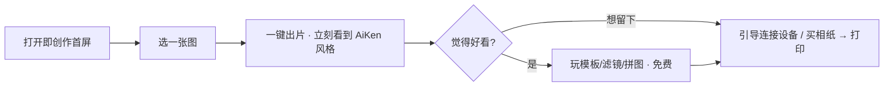

# 极印 App · 信息架构（IA）文档

> 版本：目标态 v1（待团队评审）
> 事实源：13 张界面截图（n02–n08、s01–s05、d01）+ 23 页策略文档（`四页评审PPT/_ppt_slides_dump.txt`）
> 关联：`AiKen_MessageHouse_极印版.md`、`四页评审PPT`（SI/DO、闭环体验、品牌原型）
> 说明：`App/` 目录仅有截图，无 App 源码；本 IA 以截图与策略文档为唯一事实源，不含代码、不含高保真视觉稿。

---

## 0. 目的与承接

把前几轮讨论收敛出的方向，落成**可被评审、可指导高保真设计**的信息架构。承接的已收敛决策：

| # | 决策 | 来源 |
|---|---|---|
| 1 | 产品轴粒度：**混合——默认按类，空间内可切具体设备** | 讨论 q-0 |
| 2 | 未连设备第一屏：**直接进「创作」（免登录可玩）** | 讨论 q-1 |
| 3 | 免费边界：**数字全免费，只收实体**（相纸/打印/硬件/礼盒） | 讨论 q-2 |
| 4 | 视觉基调：**全新 Creator×Jester 品牌系统**，覆盖全产品线 | 讨论 q-3 |
| 5 | 基底：**中性、产品无关**（暖白/黑/灰） | 讨论 q-3 子题 |
| 6 | 品牌人格：**不做角色**，靠风格/动效/排版/文案表达 | 讨论 q-3 子题 |
| 7 | 玩色：**暖橙系**唯一高光，只在高光时刻出现 | 讨论 q-3 子题 |
| 8 | Jester 载体：**空间内分比例**（相机动效重 / 打印机版式重） | 讨论 q-4 |
| 9 | 首屏 hook：**一键出片**（打开即选图、立刻看到 AiKen 风格） | 讨论 q-4 |

---

## 1. 现状功能归类（证据驱动）

### 1.1 逐屏功能清单

| 截图 | 区域 | 功能 | 现状归属域 |
|---|---|---|---|
| s01 | 贴纸 | 精选横滑（DIY造景/旅行图鉴）→ 推荐/灵感 → 瀑布流贴纸；悬浮"画板"按钮；提示"仅4*7" | 创作 |
| s02 | 标签 | 品类卡（姓名贴/食品调料/封口贴/洗护卫浴…）；提示"仅支持4*7相纸" | 创作 |
| s03 | 照片 | 2×2 功能块（照片打印[黑]/AI写真[青]/证件照打印/拼图打印）+ 热门推荐分类（萌宠乐园/次元艺术/百变萌娃…）+ AI 模板网格（"做同款"） | 照片打印=产品；其余=创作 |
| n02 / n03 | 最近项目 | 选 2–4 张照片 → 开始拼图 | 创作 |
| n04 | 主题写真 | 全部/男/女 → "做同款" | 创作 |
| n05 | 证件照 | 我有一张/拍一张 → 经典/风格 → "做同款" | 创作 |
| n06 | 最近项目 | 视频类项目 | 创作 |
| n07 | 我的音频 | 空状态 + 麦克风 FAB | 创作（**孤儿，无 tab 归属**） |
| n08 | 打印预览 | 离线状态 + 份数 + 打印 | 产品 |
| d01 | 设备列表 | 口袋照片打印机-D845 未连接 + 添加打印机 | 产品 |
| 全局 | 顶栏 | 切换图标 · 打印机图标+"去连接" · 搜索"手帐" | — |
| 全局 | 底栏 | 5 tab：贴纸 / 标签 / 照片 / 项目 / 用户中心 | — |

### 1.2 三域映射（现状）

- **创作**：贴纸、标签模板、AI写真、拼图、主题写真、证件照、最近项目（图/视频）、我的音频
- **产品**：照片打印、打印预览、设备列表/连接、切割历史、项目/文件夹
- **我的**：用户中心（底栏 tab）、项目/文件夹/云同步（s04/s05）、订单/耗材/会员（**策略承诺，现状未实现**）

### 1.3 孤儿功能 / 缺失环节

- **孤儿**：「我的音频」(n07) 无任何 tab 归属，悬浮在四域之外。
- **约束以提示文字呈现**：「仅4*7」「仅支持4*7相纸」以粉色小字出现，未设计进流程。
- **策略承诺未实现**（slide 5 闭环体验）：暗房 / 冲洗等待 / 即时查看 / 二创模板 / 任务解锁风格 / 传输后继续下一卷 —— 现状 UI 一件都没有。
- **AiKen 相机**：完全无位置；相机产品图仅在通用照片选择器里作为测试素材出现。

---

## 2. 当前 IA 诊断

现状 IA 是**「素材/功能轴」**，核心缺陷：

1. **tab 轴是素材/功能，不是产品**：贴纸、标签、照片、项目、账户——四个不同层级的东西被平铺成 5 个 tab。
2. **产品仅存在于模态**：产品只出现在顶栏"去连接"与设备列表模态（d01）；**添加产品不会长出专属页**，所有产品共用"照片"入口。
3. **AiKen 无位置**：没有入口、没有暗房、没有"卷"的概念。
4. **四种版式语言不统一**：四个 tab 四种布局（feed / 商品卡 / 功能宫格 / 工作区），没有统一页面模板；学习成本高、识别弱。
5. **约束未设计进流程**：「仅4*7」以提示文字出现，而非流程前置引导。
6. **孤儿功能无归属**：「我的音频」(n07) 暴露了"先做功能、后想结构"的规划方式。

**根因判断**：不是审美问题，是**设计没有对着策略做**——策略早已定义 App 应承载「风格与冲洗 → 暗房 → 二创/分享 → 任务解锁 → 传输后下一卷」，现状 UI 全部缺失。

---

## 3. 目标态 IA 树

以「**产品轴 + 创作轴**」替代现状「素材轴」。底栏收敛为 3 个一级入口，设备切换作为产品空间内的一级动作。

```mermaid
graph TD
  A[极印 App] --> B[创作 · 默认首屏 · 免登录]
  A --> C[产品 · 品类空间 · 空间内可切设备]
  A --> D[我的]

  B --> B1[免费内容流: 滤镜 / 模板 / 贴纸 / AI写真]
  B --> B2[一键出片 Hook]
  B --> B3[引导连接设备 / 购买相纸]
  B1 --> B1a[拼图 / 主题写真 / 证件照]
  B1 --> B1b[二创模板广场]
  B1 --> B1c[我的音频 · 收归创作二创]

  C --> C0[设备切换器 · 空间内一级动作]
  C --> C1[照片打印机]
  C --> C2[照片切割一体机]
  C --> C3[仿胶卷潮玩相机 AiKen]
  C1 --> C1a[照片打印 / 打印预览 / 份数]
  C1 --> C1b[Jester 偏版式: 卷36格母题 / 秩序]
  C2 --> C2a[切割 / 项目 / 最近保存]
  C3 --> C3a[拍 → 暗房(冲洗/等待) → 出片 → 分享 → 打印]
  C3 --> C3b[Jester 偏动效: 装卷 / 过片 / 盲盒揭晓 / 任务解锁]

  D --> D1[账户 / 订单]
  D2[耗材 / 会员] --> D
```

---

## 4. 导航与 Tab 模型

- **底栏一级（由 5 tab 收敛为 3）**：**创作 / 产品 / 我的**——解决维度混杂。
- **顶栏**：未连设备时，创作首屏仍完整可用（免登录）；进入产品空间后，顶栏/空间内显示**设备切换器**（替代现"去连接"的弱入口）。
- **设备切换**：产品空间内的一级动作。单设备直接进空间；多设备出现设备栏；按类产品默认可切具体设备（决策 1）。
- **首屏规则**：未连设备 → 创作流（决策 2）；连接设备后 → 产品空间解锁打印/实体产出能力。
- **约束前置**：「仅4*7」「仅支持4*7相纸」从提示文字改为创作/产品空间的流程前置说明与可用范围可视化。

---

## 5. 免费策略与一键出片落点

| 内容池 | 归属 | 收费边界 |
|---|---|---|
| 滤镜 / 模板 / 贴纸 / AI写真 / 拼图 / 主题写真 / 证件照 | **创作（全免费）** | 数字内容边际成本≈0，作为获客与留存 |
| 相纸 / 打印张数 / 硬件 / 实体增值（相册/礼盒） | **产品 + 我的（耗材/会员）** | 钱收在实体，与硬件公司身份一致 |

**一键出片 hook（决策 9）路径**：



**飞轮闭环**：免费玩 → 用户作品即传播脸（无需品牌 IP）→ 种草打印/硬件 → 钱收在实体 → 再投入。与策略 SI-3 飞轮同构。

---

## 6. Creator×Jester 语气分区

基底中性、产品无关（暖白 `#F5F2EC` / 胶片黑 `#1B1D1F` / 暖灰 `#6E7377`）；暖橙 `#FF6B35` + 暖金 `#E8A23D` 为唯一高光，仅在高光时刻（出片成功 / 解锁 / 连接成功）出现；无品牌角色，性格靠风格/动效/排版/文案表达。

| 空间 | Creator×Jester 占比 | Jester 载体（决策 8） |
|---|---|---|
| 创作首屏 | 骨架 Creator | 暖橙只在出片/解锁/连接成功时刻；清晰栅格 + 中性底 |
| 照片打印机空间 | 偏 Creator + 版式 Jester | **卷 36 格母题**、秩序感、克制引导幽默 |
| 照片切割一体机空间 | 居中 | 介于两者之间 |
| 仿胶卷潮玩相机（AiKen）空间 | 偏 Jester + 动效 Jester | **装卷/过片/冲洗进度/盲盒揭晓/任务解锁彩蛋**；文案语气玩趣 |
| 我的 | 最 Creator | 账户秩序，暖橙仅状态反馈 |

**纪律**：Jester 不能稀释 Creator 的质感——玩趣只在"时刻"里释放，不铺满全屏。

---

## 7. 现状 vs 目标态 对照

| 维度 | 现状 | 目标态 |
|---|---|---|
| tab 轴 | 素材/功能（5 tab 混杂） | 产品+创作（3 一级入口） |
| 产品可见性 | 仅模态（去连接/设备列表） | 一级空间，空间内可切设备 |
| AiKen 位置 | 无 | 独立产品空间（拍→暗房→出片→分享→打印） |
| 免费 | 模板挂"做同款"，隐性设卡 | 数字全免费，显性标免费、免登录可试 |
| 品牌性格 | 青+白+黑工具感，无主张 | Creator×Jester，暖橙+中性，语气随产品分区 |
| 孤儿功能 | 我的音频无归属 | 收归创作二创域 |
| 约束呈现 | 粉色提示文字 | 流程前置 + 可用范围可视化 |
| 首屏 | 直接进贴纸 feed | 创作首屏 + 一键出片 hook |

---

## 附：证据追溯

| 结论 | 截图证据 |
|---|---|
| 5 tab 为素材/功能轴 | 底栏 s01–s05 |
| 产品仅模态 | d01 设备列表、顶栏"去连接" |
| 约束以提示文字 | s01「仅4*7」、s02「仅支持4*7相纸」 |
| 四 tab 四版式 | s01 feed / s02 商品卡 / s03 宫格 / s04-s05 工作区 |
| 我的音频孤儿 | n07 |
| AI 模板挂"做同款"隐性设卡 | s03、n04、n05 |
| 打印机/切割/项目在产品侧 | s03 照片打印、n08 打印预览、s04-s05 切割历史/项目 |
| 策略承诺未实现 | slide 5（闭环体验）vs 现状 13 屏无暗房/冲洗/任务解锁 |
